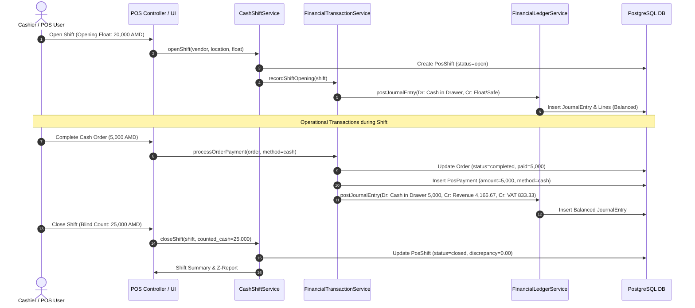

# PHASE 1 — SYSTEM ARCHITECTURE & FINANCIAL DOMAIN DESIGN
## Cash Management & Financial Operations Module

---

### 1. Architectural Principles

The Financial Operations module is designed under the **Domain-Driven Design (DDD)** and **Clean Architecture** patterns within Laravel, adhering strictly to:

1. **Single Source of Truth**: The General Ledger (`journal_entries` and `journal_entry_lines`) is the ultimate source of accounting truth. Reports (P&L, Balance Sheet, Cash Flow, Trial Balance) calculate figures exclusively from the ledger.
2. **Double-Entry Bookkeeping**: Every financial transaction must generate equal debit and credit journal entries (`SUM(debits) === SUM(credits)`).
3. **Immutability**: Once a financial transaction or journal entry is `posted`, it cannot be modified or deleted. Errors are corrected via explicit reversal entries referencing the original transaction.
4. **Tenant & Branch Isolation**: Every record is keyed by `vendor_id`. Location-specific records are additionally keyed by `location_id`. Cross-tenant queries are blocked at both ORM global scope and query levels.
5. **Idempotency**: All operations accepting money, posting ledger entries, or receiving webhooks require unique idempotency keys to prevent duplicate execution under network retries or concurrent requests.

---

## 2. Core Service Architecture

The system is decomposed into 13 dedicated domain services:

```
+---------------------------------------------------------------------------------------------------+
|                                     FINANCIAL DOMAIN SERVICES                                     |
+---------------------------------------------------------------------------------------------------+
| 1. FinancialLedgerService        | Double-entry posting, balance calculation, period closing, GL   |
| 2. FinancialTransactionService   | Orchestrates financial events across orders, payments, refunds |
| 3. CashRegisterService           | Register provisioning, device binding, status & balance checks |
| 4. CashDrawerService             | Physical drawer state, drawer kicks, hardware reconciliation   |
| 5. CashShiftService              | Opening, blind counts, expected vs actual cash, shift closing  |
| 6. CashMovementService           | Safe drops, cash-in, cash-out, petty cash disbursements        |
| 7. ExpenseService                | Expense lifecycle (Draft -> Pending -> Approved -> Paid)       |
| 8. IncomeService                 | Miscellaneous operational incomes and ancillary receipts       |
| 9. RefundService                 | Customer order refunds, void processing, reversal ledger entries|
| 10. BankReconciliationService    | Bank account management, statement import, auto & manual match |
| 11. FinancialReportingService    | Shared calculation engine for P&L, Cash Flow, Balance Sheet    |
| 12. FinancialApprovalService     | Role-based multi-tier approval thresholds and limits          |
| 13. FinancialAuditService        | Tamper-proof immutable audit logging for all monetary actions   |
+---------------------------------------------------------------------------------------------------+
```

### Detailed Service Responsibilities:

#### A. `FinancialLedgerService`
- Generates unique sequential entry numbers (`JE-YYYY-XXXXX`).
- Validates double-entry balancing invariant before insertion.
- Posts balanced lines to `journal_entries` and `journal_entry_lines`.
- Updates cached real-time account balances in `chart_of_accounts`.
- Handles accounting period close locks preventing backward-dated entries.
- Creates reversal entries linking `reversal_of_entry_id`.

#### B. `FinancialTransactionService`
- Ingests operational events (Order completion, POS payment, Expense settlement, Salary disbursement, Supplier bill payment).
- Resolves proper ledger account mappings based on transaction type, payment method, and category.
- Dispatches transactions inside ACID database transactions.

#### C. `CashRegisterService` & `CashDrawerService`
- Manages physical and virtual cash registers per branch.
- Assigns registers to active POS terminals and cashier users.
- Tracks live cash drawer balance.
- Enforces single-active-shift constraints per register.

#### D. `CashShiftService` & `CashMovementService`
- Handles cashier shift workflows: opening float, sales during shift, blind cash count upon closing.
- Computes mathematical discrepancy:
  $$\text{Discrepancy} = \text{Counted Cash} - \text{Expected Cash}$$
  $$\text{Expected Cash} = \text{Opening Float} + \text{Cash Sales} + \text{Cash In} - \text{Cash Refunds} - \text{Cash Payouts} - \text{Safe Drops} - \text{Transfers Out} + \text{Transfers In}$$
- Implements manager sign-off and approval on shift cash variances.

#### E. `ExpenseService` & `IncomeService`
- Manages operational expenses with multi-step workflow: `draft` -> `pending_approval` -> `approved` -> `paid` (or `rejected` / `cancelled`).
- Supports partial payments across multiple disbursement dates and methods.
- Enforces branch allocation and category tagging.
- Supports file uploads for receipts and supplier invoices via `StorageService`.

#### F. `RefundService`
- Processes full or partial refunds for completed orders and payments.
- Ensures refund amount cannot exceed original transaction net paid amount.
- Reverses original order revenue and restores inventory if returned.
- Creates offsetting debit to Sales Returns / Contra-Revenue and credit to Cash/Card clearing.

#### G. `BankReconciliationService`
- Manages company bank accounts and currency denominations.
- Imports bank transaction statements (CSV/OFX/Manual).
- Automates reconciliation against recorded POS settlements, supplier payments, and customer payments.
- Flags unreconciled and unmatched discrepancies.

#### H. `FinancialReportingService`
- Single centralized calculation engine for:
  - Profit & Loss Statement (Revenue - COGS = Gross Profit - Operating Expenses = Net Operating Income).
  - Cash Flow Statement (Operating, Investing, Financing cash movements).
  - Balance Sheet (Assets = Liabilities + Equity).
  - General Ledger & Trial Balance.
  - Cash Drawer & Shift Variance Reports.
- Guarantees 100% reconciliation between dashboard widgets and detailed reports.

#### I. `FinancialApprovalService` & `FinancialAuditService`
- Enforces configurable approval thresholds (e.g. expenses over $100,000 AMD or refunds require Manager / Owner approval).
- Emits immutable audit logs tracking user IP, user agent, timestamps, old/new states, and cryptographic hash verification.

---

## 3. Data Flow & Transaction Lifecycle



---

## 4. Multi-Branch & Multi-Currency Architecture

1. **Branch Consolidation**:
   - Each journal entry line includes optional `location_id`.
   - Reports can be scoped to an individual branch or consolidated across the entire tenant.
   - Inter-branch transfers record debit to Receiving Branch and credit to Originating Branch, eliminating cross-branch imbalances.

2. **Currency Architecture**:
   - System records the transaction currency (`currency`) and exchange rate (`exchange_rate`) relative to the tenant base currency (`AMD`).
   - Line amounts store both `amount` (transaction currency) and `amount_base_currency` (tenant currency) to guarantee clean consolidated financial statements.

