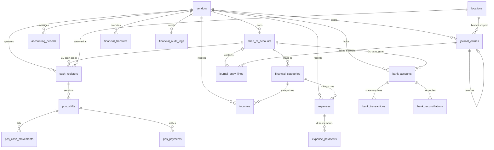

# PHASE 2 — DATABASE DESIGN & ENTITY-RELATIONSHIP ARCHITECTURE
## Cash Management & Financial Operations Module

---

### 1. Database Schema & ERD Overview

The financial schema introduces a robust, normalized relational design adhering to standard accounting principles (GAAP / IFRS / Armenian Accounting Standards). It connects cleanly with existing operational tables (`vendors`, `locations`, `users`, `orders`, `pos_shifts`, `pos_payments`, `suppliers`, `supplier_invoices`, `payroll_periods`).

---

## 2. Table Specifications & Schema Definitions

### 2.1. `chart_of_accounts`
Defines the configurable Chart of Accounts for each vendor.
- `id` (bigserial, PK)
- `vendor_id` (bigint, FK -> `vendors.id`, cascade)
- `code` (varchar 30, NOT NULL) — e.g. "2511", "2521", "5211", "6111", "7111" (Republic of Armenia Chart of Accounts standard)
- `name` (varchar 200, NOT NULL)
- `type` (varchar 30, NOT NULL) — `asset`, `liability`, `equity`, `revenue`, `expense`
- `subtype` (varchar 50, NOT NULL) — `cash`, `bank`, `accounts_receivable`, `inventory`, `accounts_payable`, `tax_payable`, `payroll_payable`, `tips_payable`, `retained_earnings`, `sales_food`, `sales_beverage`, `cost_of_goods_sold`, `operating_expense`
- `currency` (varchar 10, default 'AMD')
- `current_balance` (decimal 14,2, default 0.00)
- `is_system` (boolean, default false)
- `is_active` (boolean, default true)
- `parent_id` (bigint, nullable, FK -> `chart_of_accounts.id`, nullOnDelete)
- `description` (text, nullable)
- `timestamps`
- **Constraints**:
  - `UNIQUE (vendor_id, code)`
  - `INDEX (vendor_id, type, is_active)`

### 2.2. `accounting_periods`
Manages fiscal periods and period closing locks.
- `id` (bigserial, PK)
- `vendor_id` (bigint, FK -> `vendors.id`, cascade)
- `name` (varchar 100, NOT NULL) — e.g. "November 2026"
- `start_date` (date, NOT NULL)
- `end_date` (date, NOT NULL)
- `status` (varchar 30, default 'open') — `open`, `closing`, `closed`
- `closed_by` (bigint, nullable, FK -> `users.id`, nullOnDelete)
- `closed_at` (timestamp, nullable)
- `notes` (text, nullable)
- `timestamps`
- **Constraints**:
  - `INDEX (vendor_id, start_date, end_date, status)`

### 2.3. `journal_entries` & `journal_entry_lines`
Immutable double-entry General Ledger.
- **`journal_entries`**:
  - `id` (bigserial, PK)
  - `uuid` (uuid, unique)
  - `vendor_id` (bigint, FK -> `vendors.id`, cascade)
  - `location_id` (bigint, nullable, FK -> `locations.id`, nullOnDelete)
  - `accounting_period_id` (bigint, nullable, FK -> `accounting_periods.id`, nullOnDelete)
  - `entry_number` (varchar 60, NOT NULL) — e.g. "JE-2026-00001"
  - `entry_date` (date, NOT NULL)
  - `source_type` (varchar 60, NOT NULL) — `Order`, `PosPayment`, `Expense`, `SupplierInvoice`, `SalaryPayment`, `CashMovement`, `Refund`, `BankTransaction`, `Manual`
  - `source_id` (bigint, nullable)
  - `idempotency_key` (varchar 100, NOT NULL)
  - `status` (varchar 30, default 'posted') — `draft`, `posted`, `reversed`
  - `is_reversal` (boolean, default false)
  - `reversal_of_entry_id` (bigint, nullable, FK -> `journal_entries.id`, nullOnDelete)
  - `description` (varchar 255, NOT NULL)
  - `total_debit` (decimal 14,2, default 0.00)
  - `total_credit` (decimal 14,2, default 0.00)
  - `created_by` (bigint, nullable, FK -> `users.id`, nullOnDelete)
  - `posted_at` (timestamp, nullable)
  - `timestamps`
  - **Constraints**:
    - `UNIQUE (vendor_id, entry_number)`
    - `UNIQUE (vendor_id, idempotency_key)`
    - `INDEX (vendor_id, source_type, source_id)`
    - `INDEX (vendor_id, location_id, entry_date)`
- **`journal_entry_lines`**:
  - `id` (bigserial, PK)
  - `journal_entry_id` (bigint, FK -> `journal_entries.id`, cascade)
  - `account_id` (bigint, FK -> `chart_of_accounts.id`, restrict)
  - `location_id` (bigint, nullable, FK -> `locations.id`, nullOnDelete)
  - `type` (varchar 10, NOT NULL) — `debit`, `credit`
  - `amount` (decimal 14,2, NOT NULL)
  - `currency` (varchar 10, default 'AMD')
  - `exchange_rate` (decimal 12,6, default 1.000000)
  - `amount_base_currency` (decimal 14,2, NOT NULL)
  - `memo` (varchar 255, nullable)
  - `timestamps`
  - **Constraints**:
    - `INDEX (journal_entry_id)`
    - `INDEX (account_id, type)`

### 2.4. `cash_registers`
Registers for physical till and mobile POS management.
- `id` (bigserial, PK)
- `uuid` (uuid, unique)
- `vendor_id` (bigint, FK -> `vendors.id`, cascade)
- `location_id` (bigint, FK -> `locations.id`, cascade)
- `name` (varchar 100, NOT NULL)
- `code` (varchar 50, NOT NULL) — e.g. "REG-01"
- `pos_device_id` (bigint, nullable, FK -> `pos_devices.id`, nullOnDelete)
- `account_id` (bigint, FK -> `chart_of_accounts.id`, restrict)
- `status` (varchar 30, default 'active') — `active`, `inactive`, `maintenance`
- `current_balance` (decimal 14,2, default 0.00)
- `assigned_user_id` (bigint, nullable, FK -> `users.id`, nullOnDelete)
- `timestamps`
- **Constraints**:
  - `UNIQUE (vendor_id, location_id, code)`
  - `INDEX (vendor_id, status)`

### 2.5. `financial_categories`
Configurable income & expense categories.
- `id` (bigserial, PK)
- `vendor_id` (bigint, FK -> `vendors.id`, cascade)
- `name` (varchar 100, NOT NULL)
- `code` (varchar 50, NOT NULL)
- `type` (varchar 20, NOT NULL) — `expense`, `income`
- `account_id` (bigint, FK -> `chart_of_accounts.id`, restrict)
- `color` (varchar 30, nullable)
- `icon` (varchar 50, nullable)
- `is_active` (boolean, default true)
- `description` (text, nullable)
- `timestamps`
- **Constraints**:
  - `UNIQUE (vendor_id, type, code)`

### 2.6. `expenses` & `expense_payments`
Operating expenses with approval workflow and multi-payment support.
- **`expenses`**:
  - `id` (bigserial, PK)
  - `uuid` (uuid, unique)
  - `vendor_id` (bigint, FK -> `vendors.id`, cascade)
  - `location_id` (bigint, nullable, FK -> `locations.id`, nullOnDelete)
  - `category_id` (bigint, FK -> `financial_categories.id`, restrict)
  - `account_id` (bigint, FK -> `chart_of_accounts.id`, restrict)
  - `supplier_id` (bigint, nullable, FK -> `suppliers.id`, nullOnDelete)
  - `expense_number` (varchar 60, NOT NULL) — e.g. "EXP-2026-0001"
  - `title` (varchar 200, NOT NULL)
  - `description` (text, nullable)
  - `amount` (decimal 14,2, NOT NULL)
  - `currency` (varchar 10, default 'AMD')
  - `tax_amount` (decimal 14,2, default 0.00)
  - `expense_date` (date, NOT NULL)
  - `due_date` (date, nullable)
  - `status` (varchar 30, default 'draft') — `draft`, `pending_approval`, `approved`, `rejected`, `paid`, `partially_paid`, `cancelled`
  - `payment_method` (varchar 40, nullable) — `cash`, `bank_transfer`, `card`, `other`
  - `cash_register_id` (bigint, nullable, FK -> `cash_registers.id`, nullOnDelete)
  - `bank_account_id` (bigint, nullable, FK -> `bank_accounts.id`, nullOnDelete)
  - `paid_amount` (decimal 14,2, default 0.00)
  - `remaining_amount` (decimal 14,2, default 0.00)
  - `paid_at` (timestamp, nullable)
  - `approved_by` (bigint, nullable, FK -> `users.id`, nullOnDelete)
  - `approved_at` (timestamp, nullable)
  - `rejected_by` (bigint, nullable, FK -> `users.id`, nullOnDelete)
  - `rejected_at` (timestamp, nullable)
  - `rejection_reason` (text, nullable)
  - `attachment_path` (varchar 255, nullable)
  - `is_recurring` (boolean, default false)
  - `recurring_frequency` (varchar 30, nullable) — `daily`, `weekly`, `monthly`, `annual`
  - `idempotency_key` (varchar 100, nullable)
  - `created_by` (bigint, FK -> `users.id`, restrict)
  - `timestamps`, `softDeletes`
  - **Constraints**:
    - `UNIQUE (vendor_id, expense_number)`
    - `INDEX (vendor_id, status, expense_date)`
- **`expense_payments`**:
  - `id` (bigserial, PK)
  - `uuid` (uuid, unique)
  - `vendor_id` (bigint, FK -> `vendors.id`, cascade)
  - `expense_id` (bigint, FK -> `expenses.id`, cascade)
  - `payment_number` (varchar 60, NOT NULL)
  - `amount` (decimal 14,2, NOT NULL)
  - `currency` (varchar 10, default 'AMD')
  - `payment_date` (date, NOT NULL)
  - `payment_method` (varchar 40, NOT NULL)
  - `cash_register_id` (bigint, nullable, FK -> `cash_registers.id`, nullOnDelete)
  - `bank_account_id` (bigint, nullable, FK -> `bank_accounts.id`, nullOnDelete)
  - `reference_number` (varchar 100, nullable)
  - `notes` (text, nullable)
  - `created_by` (bigint, FK -> `users.id`, restrict)
  - `journal_entry_id` (bigint, nullable, FK -> `journal_entries.id`, nullOnDelete)
  - `idempotency_key` (varchar 100, nullable)
  - `timestamps`
  - **Constraints**:
    - `UNIQUE (vendor_id, payment_number)`
    - `INDEX (expense_id)`

### 2.7. `incomes`
Non-menu operational incomes (catering, rentals, disposal).
- `id` (bigserial, PK)
- `uuid` (uuid, unique)
- `vendor_id` (bigint, FK -> `vendors.id`, cascade)
- `location_id` (bigint, nullable, FK -> `locations.id`, nullOnDelete)
- `category_id` (bigint, FK -> `financial_categories.id`, restrict)
- `account_id` (bigint, FK -> `chart_of_accounts.id`, restrict)
- `income_number` (varchar 60, NOT NULL)
- `title` (varchar 200, NOT NULL)
- `description` (text, nullable)
- `amount` (decimal 14,2, NOT NULL)
- `currency` (varchar 10, default 'AMD')
- `income_date` (date, NOT NULL)
- `status` (varchar 30, default 'received') — `draft`, `approved`, `received`, `cancelled`
- `payment_method` (varchar 40, NOT NULL)
- `cash_register_id` (bigint, nullable, FK -> `cash_registers.id`, nullOnDelete)
- `bank_account_id` (bigint, nullable, FK -> `bank_accounts.id`, nullOnDelete)
- `received_at` (timestamp, nullable)
- `created_by` (bigint, FK -> `users.id`, restrict)
- `journal_entry_id` (bigint, nullable, FK -> `journal_entries.id`, nullOnDelete)
- `idempotency_key` (varchar 100, nullable)
- `timestamps`, `softDeletes`
- **Constraints**:
  - `UNIQUE (vendor_id, income_number)`

### 2.8. `financial_transfers`
Asset-to-asset transfers (Register to Safe, Register to Bank, Inter-branch).
- `id` (bigserial, PK)
- `uuid` (uuid, unique)
- `vendor_id` (bigint, FK -> `vendors.id`, cascade)
- `transfer_number` (varchar 60, NOT NULL)
- `from_type` (varchar 40, NOT NULL) — `cash_register`, `bank_account`, `safe`
- `from_id` (bigint, NOT NULL)
- `to_type` (varchar 40, NOT NULL) — `cash_register`, `bank_account`, `safe`
- `to_id` (bigint, NOT NULL)
- `amount` (decimal 14,2, NOT NULL)
- `currency` (varchar 10, default 'AMD')
- `transfer_date` (date, NOT NULL)
- `status` (varchar 30, default 'completed') — `pending`, `completed`, `cancelled`
- `initiated_by` (bigint, FK -> `users.id`, restrict)
- `approved_by` (bigint, nullable, FK -> `users.id`, nullOnDelete)
- `notes` (text, nullable)
- `journal_entry_id` (bigint, nullable, FK -> `journal_entries.id`, nullOnDelete)
- `idempotency_key` (varchar 100, NOT NULL)
- `timestamps`
- **Constraints**:
  - `UNIQUE (vendor_id, transfer_number)`
  - `UNIQUE (vendor_id, idempotency_key)`

### 2.9. `bank_accounts`, `bank_transactions` & `bank_reconciliations`
Commercial bank accounts and reconciliation statements.
- **`bank_accounts`**:
  - `id` (bigserial, PK)
  - `uuid` (uuid, unique)
  - `vendor_id` (bigint, FK -> `vendors.id`, cascade)
  - `location_id` (bigint, nullable, FK -> `locations.id`, nullOnDelete)
  - `account_name` (varchar 150, NOT NULL)
  - `bank_name` (varchar 150, NOT NULL)
  - `account_number` (varchar 60, NOT NULL)
  - `iban` (varchar 60, nullable)
  - `swift` (varchar 30, nullable)
  - `currency` (varchar 10, default 'AMD')
  - `opening_balance` (decimal 14,2, default 0.00)
  - `current_balance` (decimal 14,2, default 0.00)
  - `account_id` (bigint, FK -> `chart_of_accounts.id`, restrict)
  - `is_active` (boolean, default true)
  - `timestamps`
  - **Constraints**:
    - `UNIQUE (vendor_id, account_number)`
- **`bank_transactions`**:
  - `id` (bigserial, PK)
  - `uuid` (uuid, unique)
  - `vendor_id` (bigint, FK -> `vendors.id`, cascade)
  - `bank_account_id` (bigint, FK -> `bank_accounts.id`, cascade)
  - `transaction_date` (date, NOT NULL)
  - `value_date` (date, nullable)
  - `type` (varchar 20, NOT NULL) — `credit`, `debit`
  - `amount` (decimal 14,2, NOT NULL)
  - `currency` (varchar 10, default 'AMD')
  - `reference_number` (varchar 100, nullable)
  - `counterparty_name` (varchar 200, nullable)
  - `counterparty_account` (varchar 100, nullable)
  - `description` (text, nullable)
  - `reconciliation_status` (varchar 30, default 'unreconciled') — `unreconciled`, `matched`, `manually_reconciled`, `excluded`
  - `matched_source_type` (varchar 60, nullable)
  - `matched_source_id` (bigint, nullable)
  - `matched_at` (timestamp, nullable)
  - `matched_by` (bigint, nullable, FK -> `users.id`, nullOnDelete)
  - `journal_entry_id` (bigint, nullable, FK -> `journal_entries.id`, nullOnDelete)
  - `timestamps`
  - **Constraints**:
    - `INDEX (vendor_id, bank_account_id, reconciliation_status)`
    - `INDEX (vendor_id, transaction_date)`
- **`bank_reconciliations`**:
  - `id` (bigserial, PK)
  - `uuid` (uuid, unique)
  - `vendor_id` (bigint, FK -> `vendors.id`, cascade)
  - `bank_account_id` (bigint, FK -> `bank_accounts.id`, cascade)
  - `reconciliation_number` (varchar 60, NOT NULL)
  - `statement_date` (date, NOT NULL)
  - `statement_ending_balance` (decimal 14,2, NOT NULL)
  - `gl_book_balance` (decimal 14,2, NOT NULL)
  - `difference` (decimal 14,2, NOT NULL)
  - `status` (varchar 30, default 'completed') — `draft`, `completed`
  - `reconciled_by` (bigint, FK -> `users.id`, restrict)
  - `reconciled_at` (timestamp, nullable)
  - `notes` (text, nullable)
  - `timestamps`
  - **Constraints**:
    - `UNIQUE (vendor_id, reconciliation_number)`

### 2.10. `financial_approval_policies` & `financial_approval_requests`
Multi-tiered financial approval limits.
- **`financial_approval_policies`**:
  - `id` (bigserial, PK)
  - `vendor_id` (bigint, FK -> `vendors.id`, cascade)
  - `entity_type` (varchar 40, NOT NULL) — `expense`, `refund`, `void`, `transfer`, `shift_discrepancy`
  - `threshold_amount` (decimal 14,2, NOT NULL)
  - `required_role` (varchar 50, NOT NULL) — `manager`, `vendor_owner`, `accountant`
  - `auto_approve_below` (boolean, default true)
  - `is_active` (boolean, default true)
  - `timestamps`
  - **Constraints**:
    - `UNIQUE (vendor_id, entity_type)`
- **`financial_approval_requests`**:
  - `id` (bigserial, PK)
  - `uuid` (uuid, unique)
  - `vendor_id` (bigint, FK -> `vendors.id`, cascade)
  - `approvable_type` (varchar 100, NOT NULL)
  - `approvable_id` (bigint, NOT NULL)
  - `amount` (decimal 14,2, NOT NULL)
  - `status` (varchar 30, default 'pending') — `pending`, `approved`, `rejected`
  - `requested_by` (bigint, FK -> `users.id`, restrict)
  - `decided_by` (bigint, nullable, FK -> `users.id`, nullOnDelete)
  - `decided_at` (timestamp, nullable)
  - `notes` (text, nullable)
  - `timestamps`
  - **Constraints**:
    - `INDEX (vendor_id, status)`
    - `INDEX (approvable_type, approvable_id)`

### 2.11. `financial_audit_logs`
Tamper-proof financial event tracking.
- `id` (bigserial, PK)
- `uuid` (uuid, unique)
- `vendor_id` (bigint, FK -> `vendors.id`, cascade)
- `location_id` (bigint, nullable, FK -> `locations.id`, nullOnDelete)
- `user_id` (bigint, nullable, FK -> `users.id`, nullOnDelete)
- `action` (varchar 60, NOT NULL)
- `auditable_type` (varchar 100, NOT NULL)
- `auditable_id` (bigint, NOT NULL)
- `old_values` (jsonb, nullable)
- `new_values` (jsonb, nullable)
- `amount` (decimal 14,2, nullable)
- `currency` (varchar 10, nullable)
- `ip_address` (varchar 45, nullable)
- `user_agent` (text, nullable)
- `created_at` (timestamp, useCurrent)
- **Constraints**:
  - `INDEX (vendor_id, created_at)`
  - `INDEX (vendor_id, action)`
  - `INDEX (auditable_type, auditable_id)`

