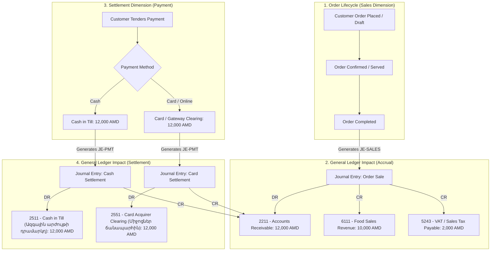
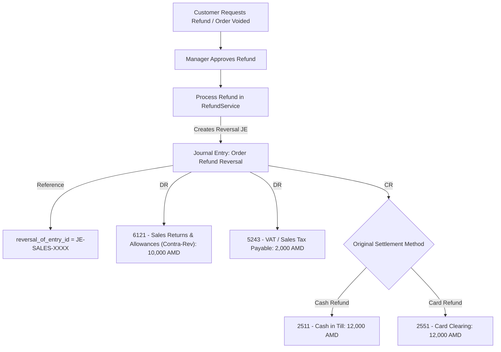
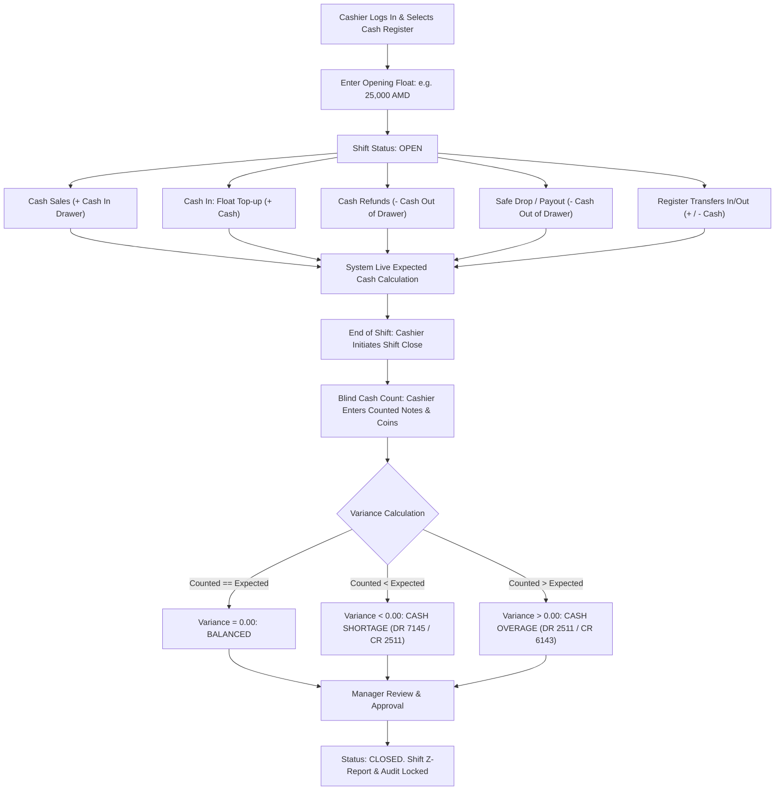
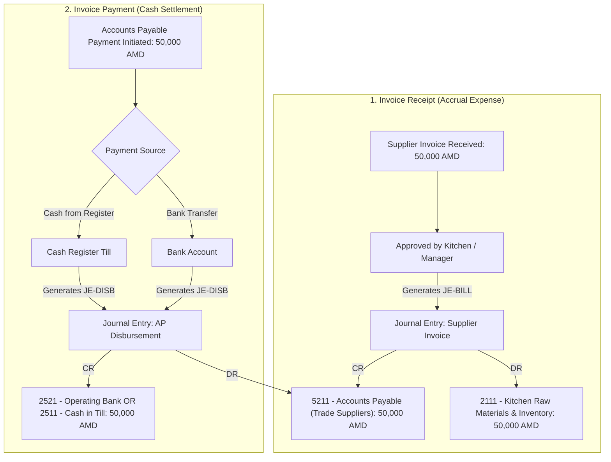
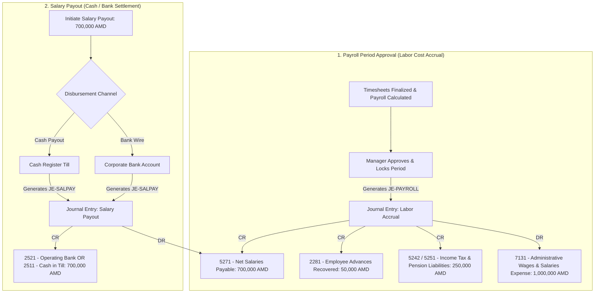
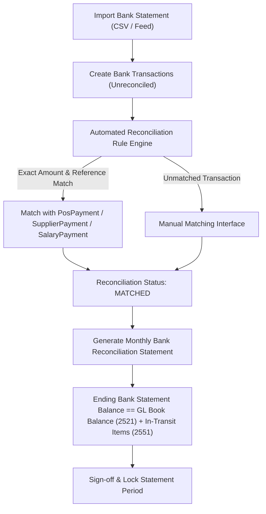

# PHASE 1 & 2 — FINANCIAL FLOW DIAGRAMS & TRANSACTION CYCLES
## Republic of Armenia Standard Chart of Accounts (ՀՀ Հաշվային Պլան)

---

### 1. Order Sale & Settlement Flow (Accrual vs Cash)

---

### 2. Order Refund & Reversal Flow

---

### 3. Cash Shift Lifecycle & Till Reconciliation Flow

---

### 4. Supplier Procurement & Accounts Payable vs Cash Flow

---

### 5. HR Payroll Accrual vs Salary Disbursement Flow

---

### 6. Bank Statement Reconciliation Flow

