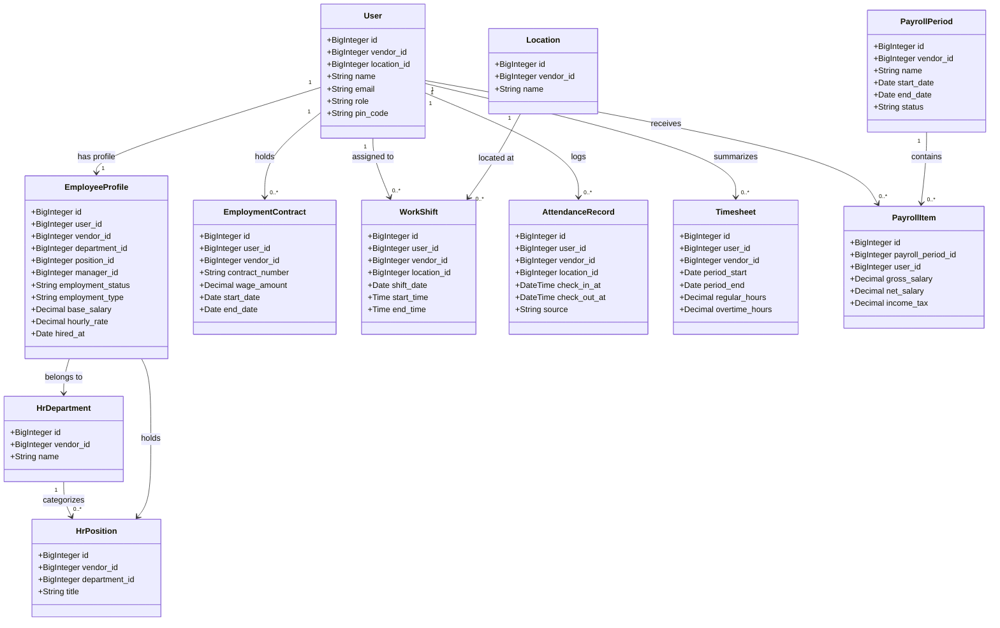

# PHASE 0 — EXISTING VS NEW FUNCTIONALITY
## Architectural Differentiation & Module Reuse Matrix

---

### Executive Overview

A critical requirement of this enhancement is to **build upon the existing QR Menu SaaS architecture** rather than creating disconnected parallel systems. This document provides the explicit functional and architectural matrix distinguishing existing capabilities from new HR & Payroll modules, proving zero duplication of data models, permissions, or administrative hierarchies.

---

## 1. Comprehensive Functional Mapping Matrix

| Functional Domain | Existing System Capability | New HR / Workforce Extension | Architectural Linkage & Reuse Strategy |
| :--- | :--- | :--- | :--- |
| **Employee Identity & Login** | `App\Models\User` - `id`, `name`, `email`, `role` - `vendor_id`, `location_id` - `pin_code`, `two_factor_*` - Auto-provisions `VendorMembership` | `App\Models\EmployeeProfile` - 1:1 relation to `User` - `dob`, `national_id_ssn`, `address` - `emergency_contact_name/phone` - `hired_at`, `terminated_at` - `status` (`active`, `on_leave`, `suspended`, `terminated`) - `employment_type` (`full_time`, `part_time`, etc.) - `department_id`, `position_id` - `manager_id` (hierarchy) - `compensation_type`, `base_salary`, `hourly_rate`, `bank_account` | **Zero duplicate employees.** `User` remains the authenticatable subject. Every staff member is a `User`. Detailed employment info extends `User->profile` via `hasOne(EmployeeProfile::class)`. |
| **Tenant & Roles Management** | `VendorMembership`, `Role`, `MembershipRole`, `MembershipPermission`, `AuthorizationService` | No new RBAC engine. Extend `PermissionCatalog` with 25+ canonical HR permissions (`hr.employees.*`, `hr.contracts.*`, etc.). | Reuses existing RBAC without changes to core engine. Custom roles can include any combination of HR permissions. |
| **Organizational Structure** | `Location` (Branches) | `HrDepartment` (Kitchen, Hall, Bar, Delivery, Admin, Accounting) `HrPosition` (Chef, Cook, Waiter, Barista, Cashier, Manager) | Fully tenant-scoped (`vendor_id`). Departments can optionally link to Locations. Reuses existing `Location` for branch assignment. |
| **Contracts & Agreements** | None (only vendor terms / SaaS subscription) | `EmploymentContract` - `contract_number`, `user_id` - `start_date`, `end_date` - `wage_amount`, `wage_type` - `probation_end_date` - `document_path`, `status` - Expiration notifications | Links to `User`. Supports sequential historical contracts. Uses existing `StorageService` for secure document storage. |
| **Rosters & Shifts** | `PosShift` (Cash drawer session for POS register: float, cash in/out, register discrepancy) | `WorkSchedule` & `WorkShift` - Work schedules for branches/departments - Staff shift planning with start/end time - Unpaid/paid break minutes - Overnight/midnight crossing support - Conflict detection & shift swapping | `PosShift` remains untouched for POS cashier operations. `WorkShift` handles human resource scheduling. |
| **Attendance & Time Clock** | None | `AttendanceRecord` - Clock-in, Clock-out, Break start/end - Verification: Signed QR, PIN, Manager, Manual - Geo/location validation - Lateness & early departure detection - `AttendanceAdjustment` with audit trail | Reuses `User` and `Location`. Leverages `TimeAwareService` for vendor local time and midnight-crossing shifts. |
| **Timesheets (Tabel)** | None | `Timesheet` - Automated aggregation of planned vs actual hours - Regular, Overtime, Night, Holiday hours - Manager verification & approval lock | Bridge between Attendance and Payroll. Once approved, timesheet is immutable and feeds directly into payroll runs. |
| **Leave & Absence** | None | `LeaveType`, `LeaveRequest`, `EmployeeLeaveBalance` - Annual, Sick, Unpaid, Personal, Maternity - Approval workflow with manager comments - Balance tracking per calendar year | Integrated with Work Schedules and Timesheets so approved leaves automatically flag on schedules and payroll. |
| **Payroll Calculation Engine**| None | `PayrollPeriod`, `PayrollItem`, `PayrollItemComponent` - Supports Monthly, Hourly, Daily, Shift, Mixed - Automated tax engine: Armenia Tax Code + generic rule driver - Income Tax, Social Security, Stamp Duty - Overtime & night wage premiums | Separate, testable engine using `decimal:2` money representation. Detailed breakdown stored in JSONB per line item. |
| **Salary Payments & Advances**| `SupplierPayment` (procurement payments only) | `SalaryPayment` - Multi-tranche, cash or bank transfer - Linked to approved payroll items `EmployeeAdvance` - Salary advance request, disbursement, and automated payroll recovery | Follows the design patterns of `SupplierPayment`. Prevents double counting or duplicate accounting entries. |
| **Employee Self-Service (ESS)**| Basic profile page (`/admin/profile`) | Enhanced ESS dashboard tab for staff: - My Shifts & Schedule - My Attendance Clock & History - My Leave Requests & Balances - My Payslips (PDF download) - My Advances | Filtered strictly to `Auth::id()`. Zero visibility into peer compensation or confidential records. |
| **HR Reports & Analytics** | Sales, orders, and POS reporting | HR Analytics suite: - Headcount & Turnover - Attendance, Lateness & Absence trends - Overtime expenditure - Salary costs by Branch, Department, Position - Export to CSV/Excel/PDF | Follows existing reporting patterns (`PosReportingController`, `InventoryReportController`). |

---

## 2. Structural Schema Comparison

---

## 3. Strict Guarantees

1. **Authentication Unbroken**: All existing users log in with their existing credentials, email, password, and optional PIN.
2. **Backward Compatibility**: Routes `/admin/team` and `admin.team.index` remain active and functional, enhanced with new HR tabs.
3. **Multi-Tenant Protection**: Every single new table contains `vendor_id` and utilizes the `BelongsToVendor` trait.
4. **Subscription Tier Integrity**: HR features gracefully obey plan entitlements (`Basic`, `Pro`, `Advanced`).

