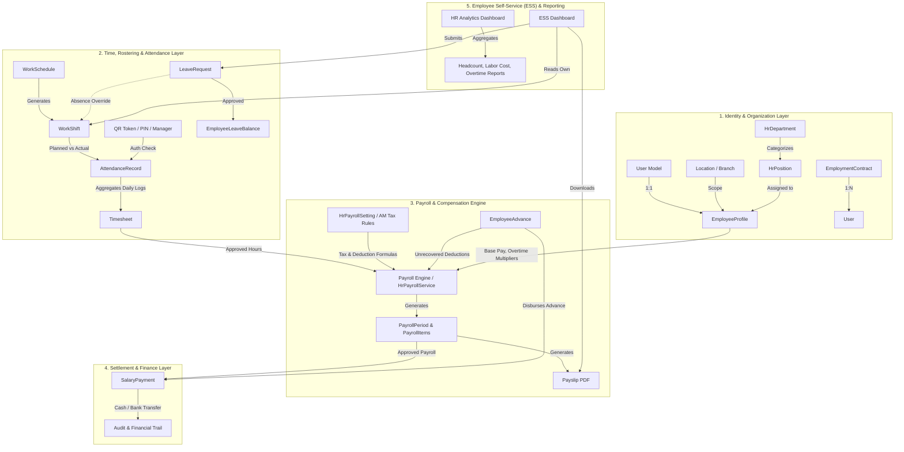

# PHASE 0 — HR & WORKFORCE ARCHITECTURE
## End-to-End System Architecture, Domain Boundaries & Data Flow

---

### 1. Architectural Philosophy & Principles

The Workforce & HR Management enhancement for QR Menu SaaS is designed following Domain-Driven Design (DDD) principles integrated cleanly inside the Laravel 13 framework. It adheres to:

1. **Strict Single-Database Tenancy**: All models inherit `BelongsToVendor` ensuring automatic `vendor_id` stamping and scoped query filtering.
2. **Immutability of Financial & Compliance Records**: Once a Payroll Period is approved and locked, or a Timesheet is signed off, the records become append-only and cannot be mutated without a supervised adjustment audit trail.
3. **Accurate Monetary Precision**: Every financial figure is calculated and persisted using standard high-precision decimals (`decimal(14, 2)` or `decimal(12, 2)`), strictly avoiding IEEE floating point errors.
4. **Separation of Payroll Calculation from Payment Settlement**: Calculating salaries and executing payouts are independent stages, preventing accidental premature disbursements.
5. **Configurable Tax and Labor Rules**: Tax formulas, overtime multipliers, and statutory contribution rates are never hardcoded in source code; they are dynamic, versioned, and effective-dated.

---

## 2. Core Subsystems & Domain Layers

---

## 3. Detailed Data Flow & Lifecycle

### 3.1. Shift Scheduling & Attendance Verification Flow
1. **Roster Creation**: The manager defines recurring weekly or monthly `WorkSchedule` rules for a specific branch or department, and creates `WorkShift` records assigned to employees.
2. **Night Shifts & Midnight Crossing**: Shifts starting e.g. at 20:00 and ending at 04:00 the following day are explicitly flagged with `cross_midnight = true`. The system calculates split night-rate premium hours (22:00 to 06:00).
3. **Time Clock (Check-in/Check-out)**:
   - **Signed QR Code**: The employee scans an encrypted, dynamic QR code generated at the restaurant's POS or manager console, or shows their own QR badge. The token expires in 60 seconds to prevent badge forwarding.
   - **PIN Entry**: Fast 4-digit PIN verification against the hashed `User->pin_code`.
   - **Manager Manual Check-in**: Direct clocking by the manager with logged rationale.
4. **Lateness & Early Departure**:
   - Compares clock-in timestamp with `WorkShift->start_time`.
   - Tolerates configured grace period (e.g. 5 minutes). Lateness beyond grace period automatically calculates tardy minutes.

### 3.2. Timesheet (Tabel) Consolidation Flow
1. At the close of each payroll interval (e.g. weekly or monthly), the system aggregates daily `AttendanceRecord` logs and matches them against `WorkShift` assignments.
2. Hours are categorized into:
   - **Regular Hours**: Hours worked within standard limits.
   - **Overtime Hours**: Hours beyond standard daily or weekly thresholds (e.g. > 8 hours/day or > 40 hours/week).
   - **Night Hours**: Hours worked between 22:00 and 06:00.
   - **Holiday / Rest Day Hours**: Hours worked on designated public holidays or scheduled rest days.
   - **Approved Paid Leave / Sick Leave Hours**: Directly pulled from approved `LeaveRequest` records.
3. The Manager reviews anomalies, makes adjustments with logged reasons via `AttendanceAdjustment`, and marks the `Timesheet` as **Approved**.

### 3.3. Payroll Computation Engine Flow
1. **Period Initialization**: Manager creates a `PayrollPeriod` (e.g. `2026-11 Monthly Payroll`) selecting all active employees or filtering by branch.
2. **Data Ingestion**: The engine pulls:
   - Approved `Timesheet` records.
   - Base salary, hourly rates, or commission details from `EmployeeProfile`.
   - Active unrecovered `EmployeeAdvance` balances.
   - Effective statutory tax rates (`HrPayrollSetting`) based on period dates.
3. **Step-by-Step Gross Salary Calculation**:
   $$\text{Base Earnings} = \text{Contract Monthly Salary} \times \frac{\text{Worked Days}}{\text{Working Days in Month}}$$
   $$\text{Overtime Pay} = \text{Overtime Hours} \times (\text{Hourly Rate} \times 1.5)$$
   $$\text{Night Pay} = \text{Night Hours} \times (\text{Hourly Rate} \times 0.3)$$
   $$\text{Bonuses} = \sum \text{Approved Bonuses}$$
   $$\text{Gross Salary} = \text{Base Earnings} + \text{Overtime Pay} + \text{Night Pay} + \text{Bonuses}$$
4. **Step-by-Step Deductions & Taxes (Armenia Standard)**:
   - **Income Tax (Եկամտային հարկ)**: $\text{Gross} \times 20\%$.
   - **Compulsory Pension Contribution (Կուտակային կենսաթոշակ)**: $5\%$ (subject to legal maximum salary ceiling).
   - **Military Stamp Fee (Դրոշմանիշային վճար)**: Tiered fixed fee based on Gross Salary bracket (1,500 AMD to 15,000 AMD).
   - **Salary Advance Recovery**: Deducts scheduled repayment from net.
5. **Net Salary Computation**:
   $$\text{Net Salary} = \text{Gross Salary} - (\text{Income Tax} + \text{Pension} + \text{Stamp Fee} + \text{Other Deductions} + \text{Advance Recovery})$$
6. **Approval & Freezing**:
   - The computed breakdown is stored in `payroll_items` and `payroll_item_components`.
   - Manager reviews the Payroll Preview.
   - Authorized user approves and locks the period (`status = locked`), archiving immutable snapshot data.

### 3.4. Payout Execution & Settlement Flow
1. Authorized accountant or manager logs payments via `salary_payments`.
2. Supports split payments (e.g. 50% Bank Transfer on 15th, 50% on 30th).
3. Updates `PayrollItem->payment_status` (`unpaid` -> `partially_paid` -> `paid`).
4. Generates electronic PDF Payslips viewable in the Employee Self-Service portal.

---

## 4. Multi-Tenant Defense-in-Depth

1. **Tenant Isolation**:
   - Every single table possesses a mandatory `vendor_id` foreign key with `ON DELETE CASCADE`.
   - Every Eloquent model implements `App\Models\Traits\BelongsToVendor`.
   - Cross-tenant data retrieval or foreign key assignment is blocked at both model event listeners and request validation rules.
2. **Location / Branch Scoping**:
   - `Location` scoping is enforced via `MembershipLocation` and `User->canAccessLocationId()`.
   - Branch managers can only view schedules, attendance, and timesheets for staff assigned to their accessible branch.
3. **Data Confidentiality (Least Privilege)**:
   - Regular staff only have access to their own records via Employee Self-Service.
   - Sensitive financial fields (`base_salary`, `net_salary`, `bank_account`, `national_id_ssn`) require explicit `hr.payroll.view` or `employees.view_sensitive` permissions.

