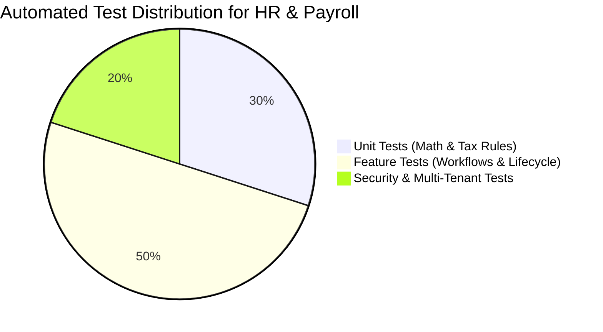

# PHASE 0 — TESTING & QA STRATEGY
## Automated Test Plan, Test Scenarios, Security Edge Cases & Regression Safeguards

---

### Executive Summary

To ensure rock-solid stability and zero regressions in the existing QR Menu platform, every HR & Payroll feature is backed by automated tests using PHPUnit. Tests are divided into Unit Tests (pure business logic and tax computation), Feature Tests (end-to-end HTTP lifecycle, database persistence, and authorization), and Security Tests (multi-tenant boundary violations and IDOR attempts).

---

## 1. Test Pyramid & Coverage Scope

---

## 2. Unit Testing Matrix

| Test Suite | Target Logic | Key Test Cases |
| :--- | :--- | :--- |
| `PayrollCalculationServiceTest` | Gross-to-Net Engine | - Fixed monthly salary calculation with full attendance - Prorated salary for mid-month hire/termination - Hourly wage computation based on regular hours - Overtime rate multiplier (1.5x) verification - Night shift premium (0.3x) between 22:00 and 06:00 - Holiday work premium (2.0x) - Zero-float precision and rounding to 2 decimal places |
| `ArmenianTaxRulesTest` | RA Statutory Deductions | - Income tax exact 20% calculation - Pension contribution 5% calculation under statutory cap - Pension contribution capped at max ceiling (1,125,000 AMD gross) - Military stamp duty tier brackets ($1,500, $3,000, $5,500, $8,500, $15,000 AMD) - Effective-dated historical rate integrity |
| `TimesheetHoursAggregatorTest` | Tabel Consolidation | - Regular vs overtime hour splitting - Midnight-crossing shift hour splitting into regular/night - Paid leave hours vs unpaid absence categorization |
| `EmployeeAdvanceRecoveryTest` | Advance Deduction | - Full advance recovery when net salary exceeds advance - Partial recovery when net salary is less than advance (capped at payable amount) - Negative net salary prevention guarantee |

---

## 3. Feature Testing Matrix

| Test Suite | Target Workflow | Key Test Cases |
| :--- | :--- | :--- |
| `EmployeeManagementTest` | Profile & Contracts | - User creation with automatic `EmployeeProfile` provision - Updating personal, banking, and emergency details - Issuing sequential employment contracts - Department and position assignment |
| `WorkScheduleAndShiftTest` | Rostering & Calendar | - Schedule template creation for branches - Creating scheduled shifts with midnight crossing - Detecting shift overlap for the same employee - Shift cancellation and status updates |
| `AttendanceAndClockTest` | Time Clock & Punch | - Clock-in and clock-out via PIN verification - Signed dynamic QR token verification and expiration - Lateness calculation based on scheduled shift - Manager manual entry and adjustments with reason log |
| `LeaveManagementTest` | Absence Workflows | - Leave request submission and balance decrement - Manager approval and rejection with review notes - Preventing leave requests exceeding remaining balance - Overlapping leave detection with scheduled shifts |
| `PayrollLifecycleTest` | End-to-End Payroll | - Initializing period -> calculating -> reviewing breakdown - Freezing & locking payroll period - Preventing modification of locked payroll records - Generating downloadable PDF payslip |
| `SalaryPaymentTest` | Disbursements | - Recording partial and full salary payout transactions - Updating `payment_status` on payroll items - Preventing overpayment beyond net salary |
| `EmployeeSelfServiceTest` | Staff Portal | - Staff viewing their own roster, attendance, and leave balance - Staff submitting leave request - Staff downloading their own payslips |

---

## 4. Security & Multi-Tenant Isolation Tests

| Test Suite | Security Domain | Verification Scenarios |
| :--- | :--- | :--- |
| `HrMultiTenantIsolationTest` | Tenant Boundary | - Tenant A cannot view, edit, or delete Tenant B's employees, profiles, contracts, shifts, attendance, or payroll - Cross-tenant foreign key assignment throws `InvalidArgumentException` - Direct ID guessing returns 404 (scoped by tenant) |
| `HrAuthorizationAndRbacTest` | Access Control | - Unauthenticated requests receive 401/302 to login - Staff without `hr.payroll.view` receive 403 on payroll routes - Manager without `hr.payroll.pay` receives 403 on payout endpoints - Sensitive fields masked unless `hr.payroll.view_sensitive` is granted |
| `EmployeeSelfServiceIdorTest` | Horizontal Privilege | - Employee X cannot view Employee Y's payslip or contracts - Employee X cannot submit leave or clock-in on behalf of Employee Y |

---

## 5. Regression Safeguards

1. Run existing test suite for:
   - `tests/Feature/EnterpriseAccessControlAdminIntegrationTest.php`
   - `tests/Feature/Security/ComprehensiveMultiTenantIsolationTest.php`
   - `tests/Feature/PosRoleWorkspacesTest.php`
   - `tests/Feature/CentralAuthorizationEngineTest.php`
2. Validate that existing `/admin/team` routes and team invitation endpoints (`VendorAdminController::storeTeamMember`) remain 100% functional.

