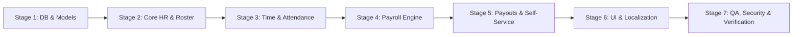

# PHASE 0 — IMPLEMENTATION PLAN & EXECUTION ROADMAP
## Step-by-Step Engineering Execution Sequence for HR & Payroll Integration

---

### Executive Overview

This plan defines the exact chronological sequence to implement, integrate, and verify the Workforce Management & HR/Payroll system inside QR Menu SaaS. Execution proceeds systematically from database migrations and domain models up to business services, controllers, frontend views, subscriptions, and automated testing suites.

---

## 1. Execution Stages & Milestones

---

## 2. Detailed Step-by-Step Plan

### Stage 1: Database Migrations & Eloquent Models
- **Step 1.1**: Create consolidated migrations for all 21 HR & Payroll tables:
  - `hr_departments`, `hr_positions`
  - `employee_profiles`, `employee_position_histories`, `employee_salary_histories`
  - `employment_contracts`, `employee_documents`
  - `work_schedules`, `work_shifts`
  - `attendance_records`, `attendance_adjustments`
  - `timesheets`
  - `leave_types`, `leave_requests`, `employee_leave_balances`
  - `payroll_periods`, `payroll_items`, `payroll_item_components`
  - `employee_advances`, `salary_payments`
  - `hr_payroll_settings`
- **Step 1.2**: Create Eloquent Models in `app/Models`:
  - `HrDepartment`, `HrPosition`, `EmployeeProfile`, `EmployeePositionHistory`, `EmployeeSalaryHistory`
  - `EmploymentContract`, `EmployeeDocument`
  - `WorkSchedule`, `WorkShift`
  - `AttendanceRecord`, `AttendanceAdjustment`
  - `Timesheet`
  - `LeaveType`, `LeaveRequest`, `EmployeeLeaveBalance`
  - `PayrollPeriod`, `PayrollItem`, `PayrollItemComponent`
  - `EmployeeAdvance`, `SalaryPayment`, `HrPayrollSetting`
  - Attach `BelongsToVendor` trait to every model.
  - Define all relationships (`User->hasOne(EmployeeProfile::class)`, `User->contracts()`, `User->shifts()`, etc.).
- **Step 1.3**: Update `app/Models/User.php` to define the 1:1 `profile()` relationship, auto-provisioning `EmployeeProfile` when staff users are created.

### Stage 2: Security, RBAC & Subscription Integration
- **Step 2.1**: Update `App\Security\Permission` with canonical HR permission constants (`HR_DEPARTMENTS_VIEW`, `HR_PAYROLL_CALCULATE`, etc.).
- **Step 2.2**: Register all HR permissions in `App\Security\PermissionCatalog` with descriptions, risk levels, and sensitivity flags.
- **Step 2.3**: Seed default HR permissions into existing system roles (`vendor_owner`, `manager`, `staff`).
- **Step 2.4**: Update `App\Security\FeatureCatalog` to register plan entitlements:
  - Basic: Employee Directory, Basic Attendance, Work Schedules.
  - Pro: Timesheets, Leaves, Contracts & Documents, Payroll Calculation, Self-Service.
  - Advanced: Advanced Reports, Custom Payroll Rules, Multi-Branch Labor Costing.
- **Step 2.5**: Seed default `hr_payroll_settings` and `leave_types` for existing and new vendors.

### Stage 3: Core Domain Services
- **Step 3.1**: Create `App\Services\HrEmployeeService`:
  - Profile management, hiring, termination, transfers, wage revisions with history logging.
- **Step 3.2**: Create `App\Services\HrScheduleService`:
  - Schedule generation, shift assignment, overnight shift support, conflict detection.
- **Step 3.3**: Create `App\Services\HrAttendanceService`:
  - Clock in/out, rotating signed QR token generation, PIN verification, lateness calculation, punch adjustments.
- **Step 3.4**: Create `App\Services\HrTimesheetService`:
  - Automated aggregation of attendance into Timesheet (regular, overtime, night, holiday, leaves).
- **Step 3.5**: Create `App\Services\HrLeaveService`:
  - Leave requests, balance tracking, approval workflows.
- **Step 3.6**: Create `App\Services\HrPayrollService`:
  - Period management, Gross-to-Net engine, Armenian tax calculation (income tax, pension cap, stamp duty), advance deduction, locked snapshot archival.
- **Step 3.7**: Create `App\Services\HrPaymentService`:
  - Disbursing salary payments, multi-tranche tracking, advance issuance and recovery.
- **Step 3.8**: Create `App\Services\HrReportService`:
  - Headcount, turnover, attendance audits, payroll cost by branch/dept.

### Stage 4: HTTP Controllers, Requests & Routes
- **Step 4.1**: Create Controllers in `App\Http\Controllers\Admin\Hr`:
  - `HrDepartmentController`, `HrPositionController`
  - `HrEmployeeController`, `HrContractController`
  - `HrScheduleController`, `HrAttendanceController`
  - `HrTimesheetController`, `HrLeaveController`
  - `HrPayrollController`, `HrPaymentController`, `HrAdvanceController`
  - `HrSelfServiceController`, `HrReportController`
- **Step 4.2**: Register clean RESTful routes in `routes/web.php` nested inside the existing Team & Access Control / Admin section.

### Stage 5: Frontend UI & Blade Views
- **Step 5.1**: Enhance the existing `/admin/team` navigation:
  - Add unified sub-navigation / tabs within the **Team & Employees** module:
    1. Employees & Profiles
    2. Contracts
    3. Departments & Positions
    4. Work Schedules
    5. Attendance & Time Clock
    6. Timesheets (Tabel)
    7. Leaves & Absences
    8. Payroll & Payslips
    9. Salary Payments & Advances
    10. Employee Self-Service (ESS)
    11. HR Reports & Analytics
    12. Access Control & Roles (Existing RBAC retained 100%)
- **Step 5.2**: Build responsive Blade views and Alpine.js components matching the existing QR Menu design system (Tailwind CSS v4, Outfit font, dark/light mode compatible).
- **Step 5.3**: Implement PDF Payslip download template.
- **Step 5.4**: Add all Armenian (`hy.json`), English (`en.json`), and Russian (`ru.json`) UI strings.

### Stage 6: Testing, QA & Verification
- **Step 6.1**: Implement Unit Tests (`tests/Unit/Hr/PayrollCalculationServiceTest.php`, `tests/Unit/Hr/ArmenianTaxRulesTest.php`).
- **Step 6.2**: Implement Feature Tests (`tests/Feature/Hr/EmployeeManagementTest.php`, `tests/Feature/Hr/AttendanceAndScheduleTest.php`, `tests/Feature/Hr/PayrollLifecycleTest.php`, `tests/Feature/Hr/EmployeeSelfServiceTest.php`).
- **Step 6.3**: Implement Security & Multi-Tenant Tests (`tests/Feature/Hr/HrMultiTenantIsolationTest.php`, `tests/Feature/Hr/HrAuthorizationTest.php`).
- **Step 6.4**: Run Pint formatter (`vendor/bin/pint --dirty --format agent`).
- **Step 6.5**: Run full test verification.
- **Step 6.6**: Produce Final Implementation & QA Report.

