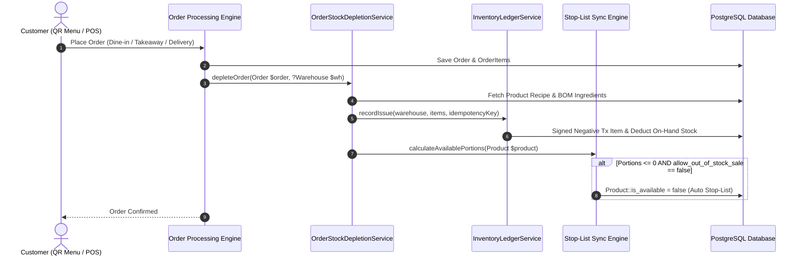

# Integration Guide: POS, QR Menu, Kitchen & Inventory Ledger

## 1. Overview
The QR Menu SaaS system bridges front-of-house guest ordering and POS operations with back-of-house recipe costing and physical warehouse inventory. This guide details how the stock depletion engine connects to order workflows, kitchen stations, and real-time broadcasts.

---

## 2. Real-Time Order Depletion Pipeline

---

## 3. Idempotency & Concurrency Protection
To prevent double depletion in distributed environments (e.g. concurrent webhook confirmations or repeat status updates):
- **Idempotency Key**: Each order depletion transaction is stamped with `ORDER-DEPLETE-{$order->id}`.
- If `depleteOrder` is invoked multiple times on the same order, `InventoryLedgerService` checks for existing idempotency keys and returns the existing transaction without deducting stock again.
- **Cancellation & Refunds**: When an order is cancelled or refunded, `reverseOrderDepletion(Order $order)` issues a receipt transaction with idempotency key `ORDER-REVERSE-{$order->id}`, restoring physical stock exactly once.

---

## 4. Multi-Branch & Kitchen Routing
- Orders submitted with a specific `location_id` / branch automatically route deductions to that location's designated kitchen warehouse (type `TYPE_KITCHEN`).
- If no branch-specific warehouse is designated, deductions default to the vendor's primary warehouse (`is_default = true`).
- Semi-finished batch withdrawals follow FEFO (First-Expired, First-Out), prioritizing items with the earliest expiration dates.

---

## 5. Webhooks & Broadcasting Events
- `InventoryStockUpdated`: Broadcast when physical stock changes, pushing updated balances to POS clients.
- `ProductAvailabilityChanged`: Broadcast when an item is automatically placed on or removed from the 86/Stop-List.
- `HaccpBreachAlert`: Broadcast to managers when critical temperature limits are breached.

