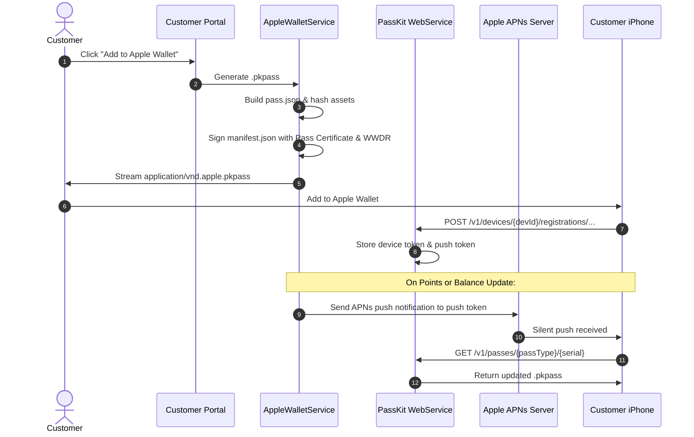
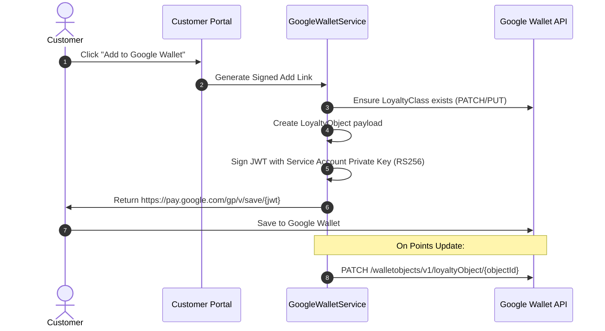

# Phase 0: Architecture Design Document
**Enterprise Loyalty & Digital Wallet Domain**
**QR Menu SaaS Platform**

---

## 1. Domain Architectural Principles

1. **Strict Multi-Tenancy**: Every entity is scoped by `vendor_id`. Cross-tenant data references or ledger updates are programmatically rejected by `BelongsToVendor` and explicit database foreign key composite constraints.
2. **Immutable Double-Entry Financial Ledgers**: Balances are never updated as solitary mutable columns. Every point or cashback credit/debit creates an immutable transaction record with previous and new balances, referencing an optional lot or order, and signed by an idempotency key.
3. **Provider Decoupling**: Apple Wallet (PassKit) and Google Wallet (REST API / JWT) share a unified domain representation (`WalletPass`) through provider-specific drivers (`AppleWalletService`, `GoogleWalletService`).
4. **Asynchronous & Idempotent Event Processing**: Order completion and refund handling are processed asynchronously via queued jobs and event listeners with deduplication. Webhooks and external POS events support idempotency keys.
5. **Zero Plaintext Secrets**: Apple certificates, private keys, APNs tokens, and Google Service Account keys are stored using AES-256-GCM via `VendorCredential` and Laravel encrypted casts.

---

## 2. Domain Structure (`app/Domains/Loyalty/`)

```
app/Domains/Loyalty/
├── Actions/
│   ├── AwardPointsAction.php
│   ├── AwardCashbackAction.php
│   ├── AwardStampsAction.php
│   ├── RedeemPointsAction.php
│   ├── RedeemCashbackAction.php
│   ├── RedeemRewardAction.php
│   ├── ReverseOrderLoyaltyAction.php
│   ├── ProcessReferralQualificationAction.php
│   └── GenerateCustomerQrTokenAction.php
├── Services/
│   ├── LoyaltyEngine.php
│   ├── PointsCalculator.php
│   ├── PointsLedgerService.php
│   ├── CashbackService.php
│   ├── TierService.php
│   ├── RewardsService.php
│   ├── StampCardService.php
│   ├── ReferralService.php
│   ├── CampaignService.php
│   ├── CustomerLoyaltyService.php
│   ├── WalletService.php
│   ├── AppleWalletService.php
│   ├── GoogleWalletService.php
│   └── TransactionReconciliationService.php
├── Models/
│   ├── LoyaltyProgram.php
│   ├── LoyaltyProgramVersion.php
│   ├── LoyaltyPointsAccount.php
│   ├── LoyaltyLedgerTransaction.php
│   ├── LoyaltyPointLot.php
│   ├── LoyaltyCashbackAccount.php
│   ├── LoyaltyCashbackTransaction.php
│   ├── LoyaltyCashbackLot.php
│   ├── LoyaltyEarningRule.php
│   ├── LoyaltyReward.php
│   ├── LoyaltyRewardRedemption.php
│   ├── LoyaltyTier.php
│   ├── LoyaltyTierHistory.php
│   ├── LoyaltyStampProgram.php
│   ├── LoyaltyStampCard.php
│   ├── LoyaltyStampTransaction.php
│   ├── LoyaltyReferral.php
│   ├── LoyaltyCampaign.php
│   ├── LoyaltyCampaignEvent.php
│   ├── LoyaltyCustomerQrToken.php
│   ├── WalletPass.php
│   ├── WalletPassDesign.php
│   ├── WalletDeviceRegistration.php
│   ├── WalletUpdateJob.php
│   └── LoyaltyAuditLog.php
├── DTOs/
│   ├── LoyaltyCalculationResult.php
│   ├── PointsTransactionDTO.php
│   ├── CashbackTransactionDTO.php
│   ├── StampAwardDTO.php
│   ├── RedemptionRequestDTO.php
│   └── PassDesignDTO.php
├── Enums/
│   ├── LoyaltyTransactionType.php
│   ├── LoyaltyTierLevel.php
│   ├── WalletProvider.php
│   ├── WalletIssuerMode.php
│   ├── CampaignTriggerType.php
│   └── StampStatus.php
├── Events/
│   ├── PointsEarned.php
│   ├── PointsRedeemed.php
│   ├── CashbackEarned.php
│   ├── CashbackRedeemed.php
│   ├── TierUpgraded.php
│   ├── StampCardCompleted.php
│   ├── RewardRedeemed.php
│   ├── WalletPassIssued.php
│   └── WalletPassUpdated.php
├── Listeners/
│   ├── ProcessOrderLoyaltyListener.php
│   ├── ProcessOrderRefundLoyaltyListener.php
│   └── SyncWalletPassOnLoyaltyUpdateListener.php
├── Jobs/
│   ├── DispatchAppleWalletPushJob.php
│   ├── UpdateGoogleWalletObjectJob.php
│   ├── ExpireLoyaltyPointsJob.php
│   ├── ProcessBirthdayCampaignsJob.php
│   └── ReconcileLoyaltyLedgersJob.php
├── Http/
│   ├── Controllers/
│   │   ├── Customer/
│   │   │   ├── CustomerLoyaltyAuthController.php
│   │   │   ├── CustomerLoyaltyPortalController.php
│   │   │   └── CustomerWalletController.php
│   │   ├── Staff/
│   │   │   └── StaffLoyaltyOperationsController.php
│   │   ├── Admin/
│   │   │   ├── LoyaltyDashboardController.php
│   │   │   ├── LoyaltyProgramController.php
│   │   │   ├── LoyaltyRulesController.php
│   │   │   ├── LoyaltyRewardsController.php
│   │   │   ├── LoyaltyTiersController.php
│   │   │   ├── LoyaltyStampCardsController.php
│   │   │   ├── LoyaltyReferralsController.php
│   │   │   ├── LoyaltyCampaignsController.php
│   │   │   ├── WalletDesignerController.php
│   │   │   └── WalletSettingsController.php
│   │   └── Webhooks/
│   │       ├── ApplePassKitWebserviceController.php
│   │       └── GoogleWalletWebhookController.php
│   └── Requests/
│       ├── CustomerEnrollmentRequest.php
│       ├── StaffPointsAdjustmentRequest.php
│       ├── StaffRewardRedemptionRequest.php
│       ├── StoreLoyaltyRuleRequest.php
│       ├── StoreRewardRequest.php
│       └── UpdateWalletDesignRequest.php
└── Policies/
    ├── LoyaltyProgramPolicy.php
    ├── LoyaltyRewardPolicy.php
    └── LoyaltyOperationPolicy.php
```

---

## 3. Subsystem Breakdown

### 3.1 Points & Cashback Accounting
- **Dual Independent Ledgers**: Points and Cashback are stored in separate accounts:
  - `LoyaltyPointsAccount` tracks current balance, lifetime earned, and lifetime redeemed.
  - `LoyaltyCashbackAccount` tracks currency balance (e.g. AMD), lifetime cashback earned, and redeemed.
- **FIFO Expiration Lots**:
  - `LoyaltyPointLot` stores points with explicit expiration dates (`expires_at`). Debits consume earliest non-expired lots first (First-In, First-Out).
  - `LoyaltyCashbackLot` stores cashback amounts with optional validity windows.
- **Transactional Integrity**:
  - All operations use `DB::transaction()` with pessimistic row locks (`lockForUpdate()`) on account records to prevent race conditions during concurrent redemptions or scans.

### 3.2 Membership Tier Engine
- Tiers: `Bronze`, `Silver`, `Gold`, `Platinum` (customizable per tenant program).
- Evaluation Criteria: Configurable evaluation window (e.g. lifetime spend, rolling 12-month spend, or earned points).
- Automatic Upgrades & Downgrades: Evaluated on order completion or scheduled rolling audit. Full audit trail recorded in `LoyaltyTierHistory`.
- Tier Benefits: Point multipliers (e.g., 1.5x for Gold), percentage discount on orders, bonus stamps, exclusive reward catalog access.

### 3.3 Digital Stamp Cards
- Visual digital stamp cards for repeat purchases (e.g., "Buy 9 coffees, get the 10th free").
- Configurable qualification:
  - Minimum order spend (e.g., 2,500 AMD).
  - Specific product or category IDs (e.g., category "Hot Drinks").
- Progress tracking: `stamps_collected`, `stamps_required`, `status` (`active`, `completed`, `redeemed`, `expired`).
- Automatic or manual staff stamp issuance upon QR scan.

### 3.4 Rewards Catalog & Redemption Engine
- Types: Order discount (fixed or percentage), free menu item, voucher code.
- Inventory control: `stock_quantity`, `max_redemptions_per_customer`, active schedule, required tier.
- Atomic Redemption: Generates a cryptographically signed redemption voucher code with a 15-minute countdown for staff verification, decrementing inventory atomically.

### 3.5 Referral Engine
- Every customer receives an obfuscated, unique referral code (e.g. `REF-7A9K2`).
- Qualification: Successful first order of referee above minimum spend threshold.
- Anti-fraud measures:
  - Same phone/email prevention
  - Same IP / device fingerprint rate limiting
  - Tenant boundary isolation
  - Referee cannot refer the referrer (cycle check)

### 3.6 Automated Campaign Engine
- Triggers:
  - `welcome`: Triggered on enrollment.
  - `birthday`: Triggered on customer's birthdate (via daily scheduled task).
  - `first_order`: Triggered on initial completed order.
  - `inactive_customer`: Triggered after X days of inactivity (e.g., 30/60/90 days).
  - `seasonal`: Time-windowed promotional multiplier or bonus points.

---

## 4. Wallet Pass Subsystems

### 4.1 Apple Wallet (PassKit)


### 4.2 Google Wallet


---

## 5. Security Architecture & QR Tokens

1. **Customer QR Tokens**: Customer identification for staff scanning uses an ephemeral, signed token (`lq_...`) with cryptographic signatures (HMAC-SHA256) and a 10-minute validity window, or static obfuscated member code (`MEM-XXXX`).
   - Customer phone numbers and emails are **never** encoded in the QR code payload.
2. **Staff Authorization**: Staff actions (`/admin/loyalty/staff/...` and POS endpoints) require `loyalty.operate` or `loyalty.manage` permissions, authenticated session or POS PIN code, and log the operating staff ID.
3. **Idempotency Keys**: All financial state mutations accept an `X-Idempotency-Key` header or request parameter stored in `loyalty_ledger_transactions.idempotency_key` with a unique constraint.

---

## 6. Verification and Testability

All calculation services (`PointsCalculator`, `TierService`, `ReferralService`, `PointsLedgerService`, `CashbackService`) will have 100% unit test coverage isolated from database state, followed by full database-backed feature tests testing concurrency, isolation, and rollbacks.

