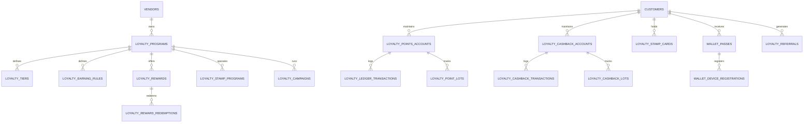

# Phase 0: Database Design Document
**Enterprise Loyalty & Digital Wallet Schema**
**PostgreSQL 16 Multi-Tenant Architecture**

---

## 1. Design Conventions & Standards

1. **Identifiers**: Bigserial primary keys (`id`) with UUIDs (`uuid`) for all publicly exposed resources (Passes, Cards, Rewards, Redemptions, Tokens).
2. **Tenant Scoping**: All tenant-owned tables have a mandatory `vendor_id` column indexed with `foreign key (vendor_id) references vendors(id) on delete cascade`.
3. **Composite Indexes**: Composite indexes on `(vendor_id, ...)` optimize tenant-scoped queries and enforce uniqueness per tenant.
4. **Immutable Ledgers**: `loyalty_ledger_transactions` and `loyalty_cashback_transactions` have no `updated_at` column or are append-only. No updates or deletions are allowed on completed financial records.
5. **PostgreSQL 16 Features**: Uses native JSONB with GIN indexes where variable criteria (rules, audiences) require fast evaluation; NUMERIC(14, 2) for financial currencies; integer for points and stamps.

---

## 2. Entity Relationship Diagram

---

## 3. Detailed Table Specifications

### 3.1 Programs & Core Configuration

#### `loyalty_programs`
- `id`: bigserial PK
- `vendor_id`: bigint NOT NULL FK -> `vendors(id)`
- `name`: varchar(255) NOT NULL
- `description`: text NULL
- `currency`: varchar(10) NOT NULL DEFAULT 'AMD'
- `is_active`: boolean NOT NULL DEFAULT true
- `points_enabled`: boolean NOT NULL DEFAULT true
- `cashback_enabled`: boolean NOT NULL DEFAULT true
- `tiers_enabled`: boolean NOT NULL DEFAULT true
- `stamps_enabled`: boolean NOT NULL DEFAULT true
- `referrals_enabled`: boolean NOT NULL DEFAULT true
- `default_points_ratio`: numeric(10,4) NOT NULL DEFAULT 1.0000 -- points per currency spent
- `points_redemption_rate`: numeric(10,4) NOT NULL DEFAULT 1.0000 -- currency discount per 1 point
- `points_expiration_days`: integer NULL -- null = never expire
- `cashback_expiration_days`: integer NULL
- `allow_concurrent_earn_and_redeem`: boolean NOT NULL DEFAULT false
- `tax_eligible_rewards`: boolean NOT NULL DEFAULT true
- `settings`: jsonb NULL
- `created_at`, `updated_at`: timestamp with time zone
- *Indexes*: `(vendor_id, is_active)`

#### `loyalty_program_versions`
- `id`: bigserial PK
- `program_id`: bigint NOT NULL FK -> `loyalty_programs(id)`
- `vendor_id`: bigint NOT NULL FK -> `vendors(id)`
- `version_number`: integer NOT NULL
- `config_snapshot`: jsonb NOT NULL
- `published_by`: bigint NULL FK -> `users(id)`
- `created_at`: timestamp with time zone

---

### 3.2 Points & Cashback Ledgers

#### `loyalty_points_accounts`
- `id`: bigserial PK
- `vendor_id`: bigint NOT NULL FK -> `vendors(id)`
- `customer_id`: bigint NOT NULL FK -> `customers(id)`
- `current_balance`: integer NOT NULL DEFAULT 0 CHECK (current_balance >= 0)
- `lifetime_earned`: integer NOT NULL DEFAULT 0
- `lifetime_redeemed`: integer NOT NULL DEFAULT 0
- `lifetime_expired`: integer NOT NULL DEFAULT 0
- `last_activity_at`: timestamp with time zone NULL
- `created_at`, `updated_at`: timestamp with time zone
- *Indexes*: `UNIQUE (vendor_id, customer_id)`

#### `loyalty_ledger_transactions`
- `id`: bigserial PK
- `uuid`: uuid NOT NULL UNIQUE
- `vendor_id`: bigint NOT NULL FK -> `vendors(id)`
- `account_id`: bigint NOT NULL FK -> `loyalty_points_accounts(id)`
- `customer_id`: bigint NOT NULL FK -> `customers(id)`
- `order_id`: bigint NULL FK -> `orders(id)`
- `staff_id`: bigint NULL FK -> `users(id)`
- `type`: varchar(30) NOT NULL -- 'earned', 'redeemed', 'expired', 'reversal', 'manual_adjustment', 'referral_bonus'
- `points`: integer NOT NULL -- positive for earn, negative for debit
- `balance_before`: integer NOT NULL
- `balance_after`: integer NOT NULL
- `idempotency_key`: varchar(64) NULL
- `reference_type`: varchar(50) NULL -- 'order', 'campaign', 'reward_redemption', 'reversal'
- `reference_id`: bigint NULL
- `notes`: text NULL
- `metadata`: jsonb NULL
- `created_at`: timestamp with time zone NOT NULL
- *Indexes*:
  - `(vendor_id, customer_id, created_at)`
  - `(vendor_id, order_id)`
  - `UNIQUE (vendor_id, idempotency_key) WHERE idempotency_key IS NOT NULL`

#### `loyalty_point_lots`
- `id`: bigserial PK
- `vendor_id`: bigint NOT NULL FK -> `vendors(id)`
- `account_id`: bigint NOT NULL FK -> `loyalty_points_accounts(id)`
- `transaction_id`: bigint NOT NULL FK -> `loyalty_ledger_transactions(id)`
- `initial_points`: integer NOT NULL
- `remaining_points`: integer NOT NULL CHECK (remaining_points >= 0)
- `expires_at`: timestamp with time zone NULL
- `is_expired`: boolean NOT NULL DEFAULT false
- `created_at`, `updated_at`: timestamp with time zone
- *Indexes*: `(vendor_id, account_id, is_expired, expires_at)`

#### `loyalty_cashback_accounts`
- `id`: bigserial PK
- `vendor_id`: bigint NOT NULL FK -> `vendors(id)`
- `customer_id`: bigint NOT NULL FK -> `customers(id)`
- `currency`: varchar(10) NOT NULL DEFAULT 'AMD'
- `current_balance`: numeric(14,2) NOT NULL DEFAULT 0.00 CHECK (current_balance >= 0)
- `lifetime_earned`: numeric(14,2) NOT NULL DEFAULT 0.00
- `lifetime_redeemed`: numeric(14,2) NOT NULL DEFAULT 0.00
- `last_activity_at`: timestamp with time zone NULL
- `created_at`, `updated_at`: timestamp with time zone
- *Indexes*: `UNIQUE (vendor_id, customer_id)`

#### `loyalty_cashback_transactions`
- `id`: bigserial PK
- `uuid`: uuid NOT NULL UNIQUE
- `vendor_id`: bigint NOT NULL FK -> `vendors(id)`
- `account_id`: bigint NOT NULL FK -> `loyalty_cashback_accounts(id)`
- `customer_id`: bigint NOT NULL FK -> `customers(id)`
- `order_id`: bigint NULL FK -> `orders(id)`
- `staff_id`: bigint NULL FK -> `users(id)`
- `type`: varchar(30) NOT NULL -- 'earned', 'redeemed', 'expired', 'reversal', 'manual_adjustment'
- `amount`: numeric(14,2) NOT NULL
- `balance_before`: numeric(14,2) NOT NULL
- `balance_after`: numeric(14,2) NOT NULL
- `idempotency_key`: varchar(64) NULL
- `notes`: text NULL
- `metadata`: jsonb NULL
- `created_at`: timestamp with time zone NOT NULL
- *Indexes*: `(vendor_id, customer_id, created_at)`

---

### 3.3 Rules, Tiers & Stamp Cards

#### `loyalty_earning_rules`
- `id`: bigserial PK
- `vendor_id`: bigint NOT NULL FK -> `vendors(id)`
- `program_id`: bigint NOT NULL FK -> `loyalty_programs(id)`
- `name`: varchar(255) NOT NULL
- `type`: varchar(30) NOT NULL -- 'spending', 'percentage', 'fixed', 'product', 'category', 'branch', 'time_window', 'multiplier'
- `reward_type`: varchar(20) NOT NULL DEFAULT 'points' -- 'points', 'cashback'
- `rate_value`: numeric(10,4) NOT NULL
- `min_order_spend`: numeric(14,2) NULL
- `max_points_per_order`: integer NULL
- `conditions`: jsonb NULL -- {product_ids: [], category_ids: [], branch_ids: [], days_of_week: [], start_time, end_time}
- `priority`: integer NOT NULL DEFAULT 0
- `is_active`: boolean NOT NULL DEFAULT true
- `created_at`, `updated_at`: timestamp with time zone
- *Indexes*: `(vendor_id, is_active, priority)`

#### `loyalty_tiers`
- `id`: bigserial PK
- `vendor_id`: bigint NOT NULL FK -> `vendors(id)`
- `program_id`: bigint NOT NULL FK -> `loyalty_programs(id)`
- `level`: integer NOT NULL -- 1=Bronze, 2=Silver, 3=Gold, 4=Platinum
- `name`: varchar(100) NOT NULL
- `min_points`: integer NOT NULL DEFAULT 0
- `min_spend`: numeric(14,2) NOT NULL DEFAULT 0.00
- `evaluation_period_days`: integer NOT NULL DEFAULT 365
- `points_multiplier`: numeric(6,2) NOT NULL DEFAULT 1.00
- `cashback_percent`: numeric(5,2) NOT NULL DEFAULT 0.00
- `order_discount_percent`: numeric(5,2) NOT NULL DEFAULT 0.00
- `color_hex`: varchar(20) NOT NULL DEFAULT '#6366f1'
- `icon_name`: varchar(50) NOT NULL DEFAULT 'star'
- `perks_description`: text NULL
- `created_at`, `updated_at`: timestamp with time zone
- *Indexes*: `UNIQUE (vendor_id, level)`

#### `loyalty_tier_histories`
- `id`: bigserial PK
- `vendor_id`: bigint NOT NULL FK -> `vendors(id)`
- `customer_id`: bigint NOT NULL FK -> `customers(id)`
- `tier_id`: bigint NOT NULL FK -> `loyalty_tiers(id)`
- `previous_tier_id`: bigint NULL FK -> `loyalty_tiers(id)`
- `reason`: varchar(50) NOT NULL -- 'points_threshold', 'spend_threshold', 'admin_adjustment', 'downgrade'
- `effective_until`: timestamp with time zone NULL
- `created_at`: timestamp with time zone NOT NULL

#### `loyalty_stamp_programs`
- `id`: bigserial PK
- `vendor_id`: bigint NOT NULL FK -> `vendors(id)`
- `name`: varchar(255) NOT NULL
- `description`: text NULL
- `stamps_required`: integer NOT NULL DEFAULT 10
- `min_order_spend`: numeric(14,2) NOT NULL DEFAULT 0.00
- `qualifying_category_ids`: jsonb NULL
- `qualifying_product_ids`: jsonb NULL
- `reward_description`: text NOT NULL
- `reward_product_id`: bigint NULL FK -> `products(id)`
- `reward_discount_amount`: numeric(14,2) NULL
- `card_validity_days`: integer NULL
- `is_active`: boolean NOT NULL DEFAULT true
- `created_at`, `updated_at`: timestamp with time zone

#### `loyalty_stamp_cards`
- `id`: bigserial PK
- `uuid`: uuid NOT NULL UNIQUE
- `vendor_id`: bigint NOT NULL FK -> `vendors(id)`
- `program_id`: bigint NOT NULL FK -> `loyalty_stamp_programs(id)`
- `customer_id`: bigint NOT NULL FK -> `customers(id)`
- `stamps_collected`: integer NOT NULL DEFAULT 0
- `stamps_required`: integer NOT NULL
- `status`: varchar(20) NOT NULL DEFAULT 'active' -- 'active', 'completed', 'redeemed', 'expired'
- `completed_at`: timestamp with time zone NULL
- `redeemed_at`: timestamp with time zone NULL
- `expires_at`: timestamp with time zone NULL
- `created_at`, `updated_at`: timestamp with time zone
- *Indexes*: `(vendor_id, customer_id, status)`

#### `loyalty_stamp_transactions`
- `id`: bigserial PK
- `vendor_id`: bigint NOT NULL FK -> `vendors(id)`
- `card_id`: bigint NOT NULL FK -> `loyalty_stamp_cards(id)`
- `order_id`: bigint NULL FK -> `orders(id)`
- `staff_id`: bigint NULL FK -> `users(id)`
- `type`: varchar(20) NOT NULL -- 'awarded', 'redeemed', 'reversed'
- `stamps`: integer NOT NULL
- `notes`: text NULL
- `created_at`: timestamp with time zone NOT NULL

---

### 3.4 Rewards & Redemptions

#### `loyalty_rewards`
- `id`: bigserial PK
- `uuid`: uuid NOT NULL UNIQUE
- `vendor_id`: bigint NOT NULL FK -> `vendors(id)`
- `title`: varchar(255) NOT NULL
- `description`: text NULL
- `reward_type`: varchar(30) NOT NULL -- 'free_product', 'fixed_discount', 'percentage_discount', 'voucher'
- `points_cost`: integer NOT NULL DEFAULT 0
- `discount_value`: numeric(14,2) NOT NULL DEFAULT 0.00
- `product_id`: bigint NULL FK -> `products(id)`
- `required_tier_id`: bigint NULL FK -> `loyalty_tiers(id)`
- `stock_quantity`: integer NULL -- null = unlimited
- `redeemed_count`: integer NOT NULL DEFAULT 0
- `max_per_customer`: integer NULL
- `is_active`: boolean NOT NULL DEFAULT true
- `starts_at`: timestamp with time zone NULL
- `ends_at`: timestamp with time zone NULL
- `image_url`: varchar(500) NULL
- `created_at`, `updated_at`: timestamp with time zone
- *Indexes*: `(vendor_id, is_active, points_cost)`

#### `loyalty_reward_redemptions`
- `id`: bigserial PK
- `uuid`: uuid NOT NULL UNIQUE
- `vendor_id`: bigint NOT NULL FK -> `vendors(id)`
- `reward_id`: bigint NOT NULL FK -> `loyalty_rewards(id)`
- `customer_id`: bigint NOT NULL FK -> `customers(id)`
- `order_id`: bigint NULL FK -> `orders(id)`
- `staff_id`: bigint NULL FK -> `users(id)`
- `redemption_code`: varchar(32) NOT NULL UNIQUE
- `points_spent`: integer NOT NULL
- `status`: varchar(20) NOT NULL DEFAULT 'pending' -- 'pending', 'used', 'cancelled', 'expired'
- `expires_at`: timestamp with time zone NOT NULL
- `used_at`: timestamp with time zone NULL
- `created_at`, `updated_at`: timestamp with time zone
- *Indexes*: `(vendor_id, customer_id, status)`

---

### 3.5 Referrals & Campaigns

#### `loyalty_referrals`
- `id`: bigserial PK
- `vendor_id`: bigint NOT NULL FK -> `vendors(id)`
- `referrer_customer_id`: bigint NOT NULL FK -> `customers(id)`
- `referred_customer_id`: bigint NOT NULL FK -> `customers(id)`
- `referral_code`: varchar(32) NOT NULL
- `status`: varchar(20) NOT NULL DEFAULT 'registered' -- 'registered', 'qualified', 'rewarded', 'fraud_rejected'
- `qualifying_order_id`: bigint NULL FK -> `orders(id)`
- `referrer_points_awarded`: integer NOT NULL DEFAULT 0
- `referred_points_awarded`: integer NOT NULL DEFAULT 0
- `qualified_at`: timestamp with time zone NULL
- `created_at`, `updated_at`: timestamp with time zone
- *Indexes*: `(vendor_id, referral_code)`, `(vendor_id, referrer_customer_id)`

#### `loyalty_campaigns`
- `id`: bigserial PK
- `vendor_id`: bigint NOT NULL FK -> `vendors(id)`
- `name`: varchar(255) NOT NULL
- `description`: text NULL
- `trigger_type`: varchar(30) NOT NULL -- 'welcome', 'birthday', 'first_order', 'inactive_customer', 'seasonal', 'custom'
- `reward_type`: varchar(20) NOT NULL -- 'points', 'cashback', 'reward_voucher'
- `reward_value`: numeric(14,2) NOT NULL
- `reward_id`: bigint NULL FK -> `loyalty_rewards(id)`
- `days_inactive`: integer NULL
- `starts_at`: timestamp with time zone NULL
- `ends_at`: timestamp with time zone NULL
- `is_active`: boolean NOT NULL DEFAULT true
- `target_audience`: jsonb NULL -- {tier_ids: [], min_orders: 0}
- `created_at`, `updated_at`: timestamp with time zone

#### `loyalty_campaign_events`
- `id`: bigserial PK
- `vendor_id`: bigint NOT NULL FK -> `vendors(id)`
- `campaign_id`: bigint NOT NULL FK -> `loyalty_campaigns(id)`
- `customer_id`: bigint NOT NULL FK -> `customers(id)`
- `reward_granted`: text NOT NULL
- `created_at`: timestamp with time zone NOT NULL
- *Indexes*: `(vendor_id, campaign_id, customer_id)`

---

### 3.6 Wallet & PassKit Architecture

#### `wallet_issuers`
- `id`: bigserial PK
- `vendor_id`: bigint NOT NULL FK -> `vendors(id)`
- `issuer_mode`: varchar(20) NOT NULL DEFAULT 'platform' -- 'platform', 'custom'
- `apple_pass_type_id`: varchar(150) NULL
- `apple_team_id`: varchar(50) NULL
- `apple_cert_credential_id`: bigint NULL FK -> `vendor_credentials(id)`
- `apple_key_credential_id`: bigint NULL FK -> `vendor_credentials(id)`
- `apple_cert_expires_at`: timestamp with time zone NULL
- `apple_status`: varchar(20) NOT NULL DEFAULT 'pending' -- 'pending', 'active', 'expired', 'error'
- `google_issuer_id`: varchar(100) NULL
- `google_service_account_credential_id`: bigint NULL FK -> `vendor_credentials(id)`
- `google_class_id`: varchar(150) NULL
- `google_status`: varchar(20) NOT NULL DEFAULT 'pending'
- `created_at`, `updated_at`: timestamp with time zone
- *Indexes*: `UNIQUE (vendor_id)`

#### `wallet_pass_designs`
- `id`: bigserial PK
- `vendor_id`: bigint NOT NULL FK -> `vendors(id)`
- `background_color`: varchar(10) NOT NULL DEFAULT '#1e293b'
- `foreground_color`: varchar(10) NOT NULL DEFAULT '#ffffff'
- `label_color`: varchar(10) NOT NULL DEFAULT '#94a3b8'
- `logo_url`: varchar(500) NULL
- `strip_image_url`: varchar(500) NULL
- `icon_url`: varchar(500) NULL
- `card_title`: varchar(100) NOT NULL DEFAULT 'Member Pass'
- `header_field`: varchar(50) NOT NULL DEFAULT 'points'
- `primary_field`: varchar(50) NOT NULL DEFAULT 'customer_name'
- `secondary_fields`: jsonb NULL
- `auxiliary_fields`: jsonb NULL
- `back_fields`: jsonb NULL
- `barcode_type`: varchar(30) NOT NULL DEFAULT 'PKBarcodeFormatQR'
- `is_published`: boolean NOT NULL DEFAULT true
- `version`: integer NOT NULL DEFAULT 1
- `created_at`, `updated_at`: timestamp with time zone
- *Indexes*: `UNIQUE (vendor_id)`

#### `wallet_passes`
- `id`: bigserial PK
- `uuid`: uuid NOT NULL UNIQUE
- `vendor_id`: bigint NOT NULL FK -> `vendors(id)`
- `customer_id`: bigint NOT NULL FK -> `customers(id)`
- `serial_number`: varchar(64) NOT NULL UNIQUE
- `authentication_token`: varchar(64) NOT NULL
- `apple_push_token`: text NULL
- `google_object_id`: varchar(150) NULL
- `pass_type_identifier`: varchar(150) NOT NULL
- `status`: varchar(20) NOT NULL DEFAULT 'active' -- 'active', 'revoked', 'expired'
- `last_pushed_at`: timestamp with time zone NULL
- `created_at`, `updated_at`: timestamp with time zone
- *Indexes*:
  - `(vendor_id, customer_id)`
  - `(pass_type_identifier, serial_number)`

#### `wallet_device_registrations`
- `id`: bigserial PK
- `vendor_id`: bigint NOT NULL FK -> `vendors(id)`
- `pass_id`: bigint NOT NULL FK -> `wallet_passes(id)`
- `device_library_identifier`: varchar(100) NOT NULL
- `push_token`: text NOT NULL
- `created_at`, `updated_at`: timestamp with time zone
- *Indexes*:
  - `UNIQUE (pass_id, device_library_identifier)`

---

### 3.7 Customer QR Tokens, Staff Auditing & Consents

#### `loyalty_customer_qr_tokens`
- `id`: bigserial PK
- `vendor_id`: bigint NOT NULL FK -> `vendors(id)`
- `customer_id`: bigint NOT NULL FK -> `customers(id)`
- `token`: varchar(64) NOT NULL UNIQUE
- `expires_at`: timestamp with time zone NOT NULL
- `used_at`: timestamp with time zone NULL
- `created_at`: timestamp with time zone NOT NULL
- *Indexes*: `(vendor_id, token, expires_at)`

#### `loyalty_audit_logs`
- `id`: bigserial PK
- `vendor_id`: bigint NOT NULL FK -> `vendors(id)`
- `staff_id`: bigint NULL FK -> `users(id)`
- `customer_id`: bigint NULL FK -> `customers(id)`
- `action`: varchar(50) NOT NULL -- 'points_adjusted', 'cashback_adjusted', 'reward_redeemed', 'tier_overridden', 'pass_revoked'
- `details`: jsonb NOT NULL
- `ip_address`: varchar(45) NULL
- `user_agent`: text NULL
- `created_at`: timestamp with time zone NOT NULL
- *Indexes*: `(vendor_id, action, created_at)`

